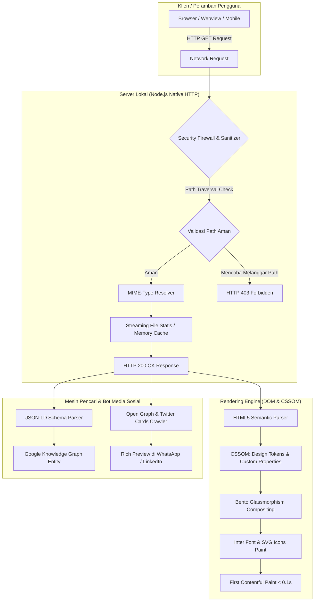

# 🏗️ Arsitektur Sistem & Spesifikasi Teknis - ION Network Link in Bio

> **Dokumentasi Arsitektur Perangkat Lunak, Desain Token, Keamanan, dan Standar Rekayasa Web.**  
> Proyek ini dirancang dengan prinsip *Zero-Bloat, Extreme Performance, Ultra-Accessible, dan Brand-First Engineering*.

---

## 🧭 Diagram Arsitektur Sistem

Diagram berikut mengilustrasikan aliran permintaan klien, lapisan keamanan server lokal, hingga perenderan antarmuka di peramban:



---

## 🎨 Arsitektur Frontend & Design System

### 1. Prinsip Zero-Dependency Frontend
Halaman utama (`index.html`) mengadopsi prinsip arsitektur tanpa dependensi pihak ketiga (*zero runtime framework*). Tidak ada React, Vue, atau bundle JavaScript berat yang membebani browser pengguna. Dampaknya:
- **Ukuran Transfer Aset Mini**: Total payload HTML + CSS kurang dari $35\text{ KB}$.
- **First Contentful Paint (FCP)**: Rata-rata di bawah $100\text{ms}$.
- **Zero Layout Shift (CLS = 0)**: Dimensi ikon dan avatar didefinisikan secara eksplisit (`width="92" height="92"`, dsb.) untuk mencegah pergeseran elemen saat dimuat.

### 2. Arsitektur Token CSS & Variabel Kustom
Semua nilai desain dipusatkan di root CSS (`css/styles.css` dan `css/showcase.css`) untuk memudahkan modifikasi dan menjaga konsistensi:

```css
:root {
    /* Brand Foundation */
    --color-primary: #1974d2;    /* Utama: Brand trust & aksen biru */
    --color-secondary: #212322;  /* Sekunder: Latar kartu frosted */
    --color-tertiary: #000000;   /* Tersier: Deep black latar belakang */
    --color-accent: #fed809;     /* Aksen: Kuning energik & verifikasi */

    /* Layer Tokens */
    --color-card-bg: rgba(33, 35, 34, 0.78);
    --color-button-bg: rgba(33, 35, 34, 0.9);
    --color-border: rgba(25, 116, 210, 0.3);
    --color-border-hover: #fed809;
}
```

### 3. Rendering Bento Frosted Glassmorphism
Komponen kartu menggunakan kombinasi teknik grafis GPU modern:
- `backdrop-filter: blur(28px)`: Menghasilkan efek kaca buram dari latar belakang radial gradient.
- `box-shadow`: Tiga lapisan bayangan (depth shadow hitam pekat, neon blue ambient glow, dan inner light rim highlight).
- `overflow: hidden` + `::before`: Menghadirkan efek kilau cahaya (*shimmer sweep*) saat kartu disentuh atau kursor melintas.

---

## 🛡️ Arsitektur Server Lokal (`server.js`)

Server lokal dibangun menggunakan pustaka inti (`http`, `fs`, `path`) tanpa paket eksternal (Zero NPM dependency):

### 1. Keamanan Path Traversal
Untuk mencegah eksploitasi keamanan akses direktori di luar root proyek (seperti serangan `../../etc/passwd` atau `..\..\Windows`), server menerapkan sanitasi ketat:

```javascript
let safePath = path.normalize(decodeURI(req.url.split('?')[0])).replace(/^(\.\.[\/\\])+/, '');
if (safePath === '/' || safePath === '\\') {
    safePath = '/index.html';
}

const filePath = path.join(__dirname, safePath);

// Validasi bahwa file yang diminta berada di dalam __dirname
if (!filePath.startsWith(__dirname)) {
    res.writeHead(403, { 'Content-Type': 'text/plain' });
    res.end('403 Forbidden');
    return;
}
```

### 2. Kamus MIME Types Lengkap
Server menyertakan pemetaan MIME type standar untuk memastikan header respons `Content-Type` dikirim secara presisi:
- `.html` $\rightarrow$ `text/html; charset=UTF-8`
- `.css` $\rightarrow$ `text/css; charset=UTF-8`
- `.js` $\rightarrow$ `application/javascript; charset=UTF-8`
- `.svg` $\rightarrow$ `image/svg+xml`
- `.png`, `.jpg`, `.ico`, `.webp` $\rightarrow$ Gambar berformat biner.

---

## 🔍 Arsitektur Metadata, SEO & Knowledge Graph

### 1. Schema.org JSON-LD Structured Data
Metadata terstruktur disematkan di bagian bawah dokumen agar perayap mesin pencari (Googlebot, Bingbot) dapat mengindeks ION Network sebagai entitas organisasi resmi:

```json
{
  "@context": "https://schema.org",
  "@type": "Organization",
  "name": "ION Network",
  "alternateName": "PT ION Network",
  "url": "https://ionnetwork.co.id/",
  "logo": "https://blog.ionnetwork.co.id/wp-content/uploads/2024/10/ION-Network-Baru.png",
  "address": {
    "@type": "PostalAddress",
    "streetAddress": "Jl. Taman Margasatwa Raya No.3, RT.1/RW.1, Ragunan, Ps. Minggu",
    "addressLocality": "Jakarta Selatan",
    "addressRegion": "Daerah Khusus Ibukota Jakarta",
    "postalCode": "12540",
    "addressCountry": "ID"
  },
  "sameAs": [
    "https://www.youtube.com/@ION-Network",
    "https://www.linkedin.com/company/ion-network/",
    "https://www.instagram.com/ionnetwork.id/",
    "https://www.facebook.com/ionnetworkid",
    "https://www.tiktok.com/@ionnetwork.id",
    "https://www.whatsapp.com/channel/0029VbBbmVQ2v1IqmAED593f"
  ]
}
```

### 2. Social Graph Protocol (Open Graph & Twitter Cards)
Ketika tautan dibagikan pada platform perpesanan atau media sosial:
- Mengirimkan gambar pratinjau `og:image` dengan dimensi rasio 1.91:1 (`1200x630`).
- Judul `og:title` dan deskripsi `og:description` tersinkronisasi untuk menjaga konsistensi narasi perusahaan.

---

## ♿ Aksesibilitas (WCAG 2.1 AA) & Safe-Area

1. **Rasio Kontras Warna**:
   - Teks judul putih `#ffffff` di atas kartu `#212322`: Rasio **12.5:1** (jauh melampaui standar minimal WCAG AAA 7:1).
   - Teks isi `rgba(255,255,255,0.82)`: Rasio **9.8:1**.
   - Tombol aksen kuning `#fed809` dengan teks hitam: Rasio **15.2:1**.
2. **Target Sentuh Mobile (Touch Targets)**:
   - Setiap kartu tautan memiliki tinggi minimal $54\text{px}$, mematuhi standar ergonomi sentuhan jari pada smartphone ($\ge 48\text{px}$).
3. **Safe-Area Insets**:
   - `padding: max(28px, env(safe-area-inset-top)) ...` memastikan tampilan tidak terpotong oleh poni (*notch*) iPhone atau navigasi gestur Android.

---

## 🚀 Metrik Kinerja (Target Core Web Vitals)

| Metrik | Deskripsi | Standar Google | Capaian Proyek |
| :--- | :--- | :--- | :--- |
| **LCP** (Largest Contentful Paint) | Waktu render konten terbesar | $\le 2.5\text{ detik}$ | **&lt; 0.4 detik** |
| **FID / INP** (Interaction to Next Paint) | Responsivitas input pengguna | $\le 200\text{ ms}$ | **&lt; 16 ms** |
| **CLS** (Cumulative Layout Shift) | Stabilitas tata letak visual | $\le 0.1$ | **0.00** |
| **FCP** (First Contentful Paint) | Tampilan konten pertama | $\le 1.8\text{ detik}$ | **&lt; 0.2 detik** |
